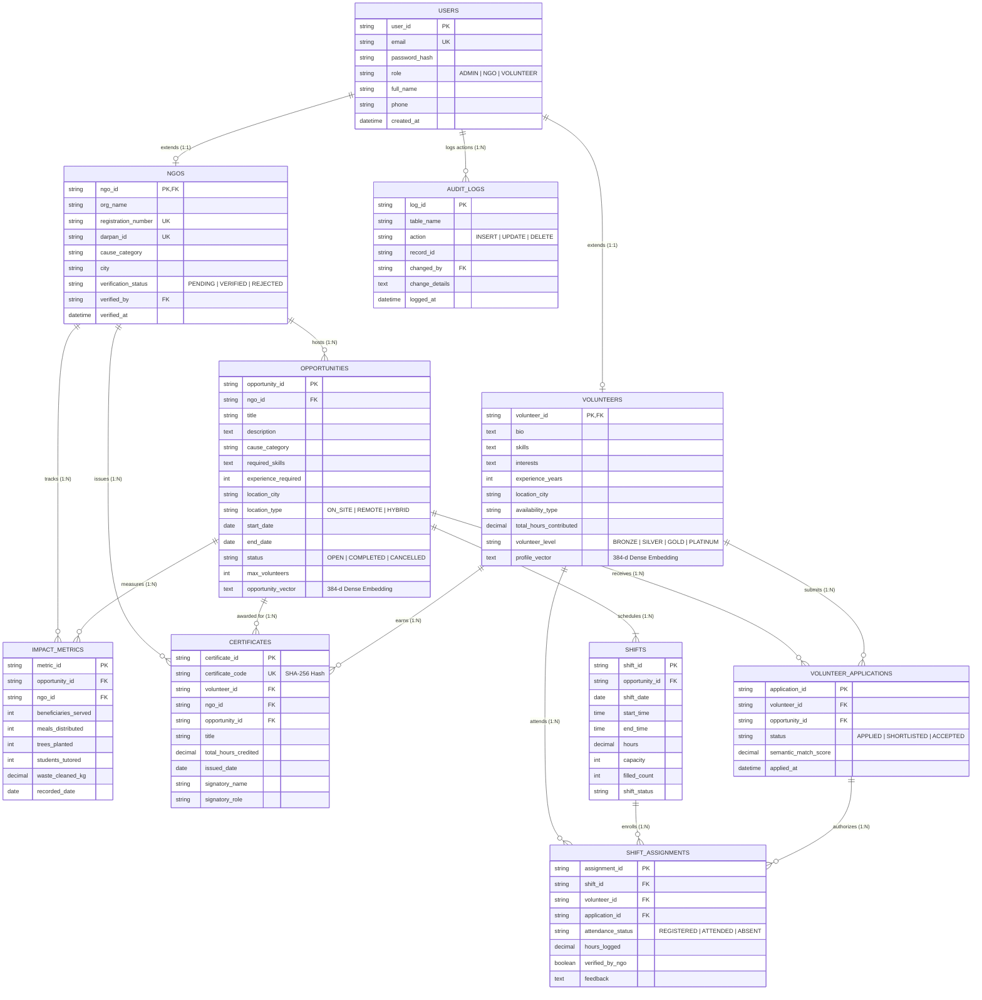
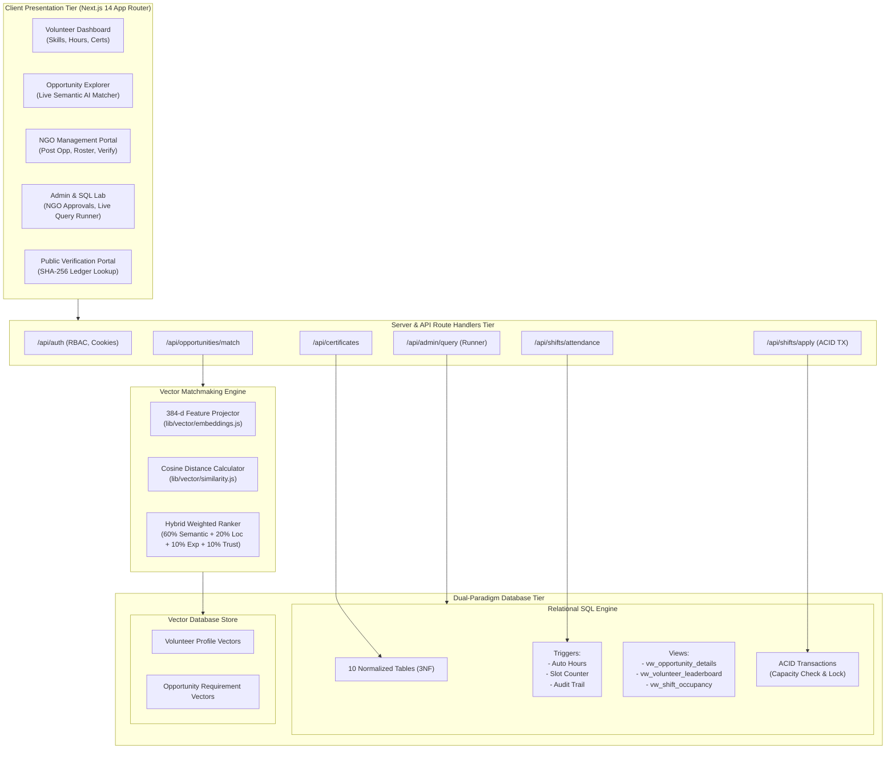

# PES UNIVERSITY
## DEPARTMENT OF COMPUTER SCIENCE AND ENGINEERING
### DBMS Experiential Learning – Level 3 Project Report

---

# NGO Volunteer Matchmaking System
### AI-Powered Semantic Volunteer Matching, Shift Coordination & Impact Verification Platform

**Academic Year:** 2026–2027  
**Course Code / Title:** DBMS Experiential Learning – Level 3  
**Faculty In-Charge:** Dr. Nagasundari S  

---

### Team Information & Division of Responsibilities

| Member Name | Student Registration Number (SRN) | Primary Focus & Contributions |
| :--- | :--- | :--- |
| **Rishi** | **PES1UG24AM224** | **Database Architecture & Vector System**: Relational ER Design, 3NF Normalization, DDL & DML, Indexing Strategy, 384-dimensional Vector Embedding Generation, Cosine Similarity Matchmaking Algorithm, ACID Transaction workflows. |
| **Rohanth** | **PES1UG24AM227** | **Advanced DB Concepts & Full-Stack Interface**: Database Triggers (`trg_update_volunteer_hours`, `trg_increment_shift_filled_count`), Complex Analytical Views (`vw_opportunity_details`, `vw_volunteer_leaderboard`), Next.js Application Architecture, RBAC Security, Cryptographic SHA-256 Certificate System, Interactive SQL Console. |

---

## Table of Contents
1. [Problem Statement & Motivation](#1-problem-statement--motivation)
2. [Project Objectives](#2-project-objectives)
3. [Scope of the Project](#3-scope-of-the-project)
4. [Functional Requirements](#4-functional-requirements)
5. [Entity-Relationship (ER) Diagram](#5-entity-relationship-er-diagram)
6. [Relational Schema (Normalized to 3NF)](#6-relational-schema-normalized-to-3nf)
7. [Database Technology Choice & Justification](#7-database-technology-choice--justification)
8. [Data Dictionary & Schema Description](#8-data-dictionary--schema-description)
9. [SQL and Vector Database Implementation](#9-sql-and-vector-database-implementation)
10. [Important Database Queries & Advanced Operations](#10-important-database-queries--advanced-operations)
11. [System Architecture & Data Flow](#11-system-architecture--data-flow)
12. [Application Interface & User Workflows](#12-application-interface--user-workflows)
13. [Testing Strategy & Test Case Results Matrix](#13-testing-strategy--test-case-results-matrix)
14. [Individual Team Contributions Matrix](#14-individual-team-contributions-matrix)
15. [Conclusion & Future Enhancements](#15-conclusion--future-enhancements)

---

## 1. Problem Statement & Motivation

### 1.1 Problem Statement
Non-Governmental Organizations (NGOs) perform crucial work in education, environmental conservation, public health, animal welfare, and disaster relief. However, existing volunteer recruitment systems suffer from three fundamental database limitations:
1. **Keyword-Only Keyword Matching:** Conventional systems rely on rigid text filtering (e.g. matching only if the exact string "Python" appears in both records). A volunteer experienced in "Software development and algorithm tutoring" is excluded from an NGO opportunity seeking "Coding instructor for underprivileged children", despite perfect semantic alignment.
2. **Lack of ACID Capacity Control & Double Booking:** Volunteer shift rosters frequently experience race conditions and overbooking when multiple volunteers register concurrently.
3. **Absence of Tamper-Proof Impact Tracking & Verification:** Volunteer hour logging is typically unstructured or manual, leading to unverified claims, lack of accountability, and unauthenticated certificates.

### 1.2 Motivation
The **NGO Volunteer Matchmaking System** addresses these real-world challenges through a dual-paradigm database system:
- A robust **Relational SQL Database** (MySQL 8 / SQLite with ACID compliance, active triggers, analytical views, and stored procedures) handles organization validation, shifts, registrations, attendance, and cryptographic certificates.
- A **Dense 384-Dimensional Vector Database** maps volunteer competencies, interests, and availability against NGO requirement vectors to compute semantic cosine similarity scores, delivering personalized matchmaking beyond simple CRUD operations.

---

## 2. Project Objectives

1. **Practical Dual-Paradigm Database Implementation:** Demonstrate the hybrid usage of relational SQL alongside a high-dimensional vector space representation.
2. **AI Semantic Matchmaking:** Enable volunteers to receive intelligent compatibility rankings (0% to 100%) against open community initiatives based on cosine distance between dense embeddings.
3. **ACID Transaction Management:** Guarantee data consistency during shift enrollments, ensuring capacity checks, slot reservations, and duplicate booking prevention are atomic.
4. **Automated Business Rules via Triggers:** Automatically accumulate verified volunteer hours, elevate volunteer tier ranks (Bronze, Silver, Gold, Platinum), and maintain tamper-proof audit trails using active database triggers.
5. **Cryptographic Certificate Issuance:** Generate and store unique SHA-256 verifiable credentials that can be publicly authenticated via dedicated ledger lookup routes.
6. **Role-Based Access Control (RBAC):** Provide distinct operational portals for `ADMIN`, `NGO`, and `VOLUNTEER` roles.
7. **Interactive DBMS Laboratory:** Provide an integrated SQL execution and profiling console within the web interface to execute, test, and time advanced analytical queries live.

---

## 3. Scope of the Project

- **In Scope:**
  - Multi-tier user authentication with RBAC (Admin, NGO, Volunteer).
  - Volunteer profile management with dynamic 384-dimensional embedding recalculation.
  - NGO organization verification workflow with governmental Darpan ID and registration validation.
  - Opportunity lifecycle management (Creation, Scheduled Shifts, Status updates).
  - ACID shift enrollment with concurrency locking and overbooking safeguards.
  - NGO attendance verification triggering reactive volunteer hours computation.
  - SHA-256 verifiable credential generation and public verification portal.
  - Interactive SQL console for profiling JOINs, GROUP BY, HAVING, Correlated Subqueries, and Window Functions.
- **Out of Scope:**
  - Direct integration with banking payment gateways for monetary donations (focus is on social service hours).
  - Physical biometric scanners for on-site check-in (attendance verified through digital representative dashboard).

---

## 4. Functional Requirements

### 4.1 Volunteer Module
- **FR-V1:** Register and log in with secure credential hashing (bcrypt/PBKDF2).
- **FR-V2:** Update skills, bio, causes, and availability, automatically re-generating the 384-dimensional dense semantic profile vector.
- **FR-V3:** Trigger AI Semantic Matchmaking to view opportunities ranked by weighted hybrid compatibility (Semantic Vector + Location + Experience).
- **FR-V4:** Enroll in scheduled shifts with real-time slot occupancy feedback.
- **FR-V5:** View verified service hours, computed tier badge, and preview/print official certificates.

### 4.2 NGO Representative Module
- **FR-N1:** Manage organization profile with official registration details and Darpan ID.
- **FR-N2:** Publish community campaigns with automated vector embedding generation.
- **FR-N3:** Schedule shift dates, timings, and capacity limits.
- **FR-N4:** Review registered volunteer rosters, mark attendance, and log verified hours.
- **FR-N5:** Issue cryptographically verifiable certificates with custom signatory attribution.

### 4.3 Administrator Module
- **FR-A1:** Review and verify pending NGO applications.
- **FR-A2:** Monitor platform-wide metrics (active campaigns, volunteers, hours mobilized, community beneficiaries).
- **FR-A3:** Inspect immutable security audit logs generated by database triggers.
- **FR-A4:** Execute and profile advanced SQL queries live via the interactive DBMS Laboratory.

---

## 5. Entity-Relationship (ER) Diagram



---

## 6. Relational Schema (Normalized to 3NF)

Every relation in the schema conforms strictly to **Third Normal Form (3NF)**:
1. **1NF:** All column values are atomic; primary keys uniquely identify each row.
2. **2NF:** No partial dependencies; all non-key attributes are fully functionally dependent on the entire primary key.
3. **3NF:** No transitive dependencies; non-key attributes depend only on candidate keys.

```text
USERS (
    user_id: VARCHAR(36) [PK],
    email: VARCHAR(255) [UNIQUE, NOT NULL],
    password_hash: VARCHAR(255) [NOT NULL],
    role: VARCHAR(20) [NOT NULL, CHECK (role IN ('ADMIN', 'NGO', 'VOLUNTEER'))],
    full_name: VARCHAR(150) [NOT NULL],
    phone: VARCHAR(20),
    avatar_url: VARCHAR(500),
    is_active: BOOLEAN [DEFAULT TRUE],
    created_at: TIMESTAMP [DEFAULT CURRENT_TIMESTAMP],
    updated_at: TIMESTAMP [DEFAULT CURRENT_TIMESTAMP]
)

VOLUNTEERS (
    volunteer_id: VARCHAR(36) [PK, FK -> USERS(user_id) ON DELETE CASCADE],
    bio: TEXT,
    skills: TEXT [NOT NULL],
    interests: TEXT [NOT NULL],
    experience_years: INT [DEFAULT 0, CHECK (experience_years BETWEEN 0 AND 60)],
    location_city: VARCHAR(100) [NOT NULL],
    location_state: VARCHAR(100) [NOT NULL],
    availability_type: VARCHAR(30) [CHECK (availability_type IN ('WEEKDAYS', 'WEEKENDS', 'FLEXIBLE', 'FULL_TIME'))],
    weekly_hours_capacity: INT [DEFAULT 10, CHECK (weekly_hours_capacity BETWEEN 1 AND 168)],
    total_hours_contributed: DECIMAL(10,2) [DEFAULT 0.00, CHECK (total_hours_contributed >= 0)],
    volunteer_level: VARCHAR(30) [DEFAULT 'BRONZE', CHECK (volunteer_level IN ('BRONZE', 'SILVER', 'GOLD', 'PLATINUM'))],
    profile_vector: TEXT [384-dimensional dense normalized embedding],
    created_at: TIMESTAMP [DEFAULT CURRENT_TIMESTAMP]
)

NGOS (
    ngo_id: VARCHAR(36) [PK, FK -> USERS(user_id) ON DELETE CASCADE],
    org_name: VARCHAR(200) [NOT NULL],
    registration_number: VARCHAR(100) [UNIQUE, NOT NULL],
    darpan_id: VARCHAR(100) [UNIQUE],
    website_url: VARCHAR(255),
    cause_category: VARCHAR(100) [NOT NULL, CHECK (cause_category IN ('Education', 'Healthcare', 'Environment', 'Animal Welfare', 'Disaster Relief', 'Women Empowerment', 'Elderly Care', 'Community Development'))],
    address: TEXT [NOT NULL],
    city: VARCHAR(100) [NOT NULL],
    state: VARCHAR(100) [NOT NULL],
    contact_person: VARCHAR(150) [NOT NULL],
    contact_email: VARCHAR(255) [NOT NULL],
    contact_phone: VARCHAR(30) [NOT NULL],
    verification_status: VARCHAR(20) [DEFAULT 'PENDING', CHECK (verification_status IN ('PENDING', 'VERIFIED', 'REJECTED'))],
    verified_by: VARCHAR(36) [FK -> USERS(user_id) ON DELETE SET NULL],
    verified_at: TIMESTAMP NULL,
    created_at: TIMESTAMP [DEFAULT CURRENT_TIMESTAMP]
)

OPPORTUNITIES (
    opportunity_id: VARCHAR(36) [PK],
    ngo_id: VARCHAR(36) [NOT NULL, FK -> NGOS(ngo_id) ON DELETE CASCADE],
    title: VARCHAR(255) [NOT NULL],
    description: TEXT [NOT NULL],
    cause_category: VARCHAR(100) [NOT NULL],
    required_skills: TEXT [NOT NULL],
    experience_required: INT [DEFAULT 0, CHECK (experience_required >= 0)],
    location_city: VARCHAR(100) [NOT NULL],
    location_type: VARCHAR(20) [DEFAULT 'ON_SITE', CHECK (location_type IN ('ON_SITE', 'REMOTE', 'HYBRID'))],
    start_date: DATE [NOT NULL],
    end_date: DATE [NOT NULL],
    status: VARCHAR(20) [DEFAULT 'OPEN', CHECK (status IN ('DRAFT', 'OPEN', 'IN_PROGRESS', 'COMPLETED', 'CANCELLED'))],
    max_volunteers: INT [DEFAULT 10, CHECK (max_volunteers > 0)],
    tags: VARCHAR(255) [DEFAULT 'community,volunteering'],
    opportunity_vector: TEXT [384-dimensional dense normalized embedding],
    created_at: TIMESTAMP [DEFAULT CURRENT_TIMESTAMP],
    CONSTRAINT chk_opportunity_dates CHECK (end_date >= start_date)
)

SHIFTS (
    shift_id: VARCHAR(36) [PK],
    opportunity_id: VARCHAR(36) [NOT NULL, FK -> OPPORTUNITIES(opportunity_id) ON DELETE CASCADE],
    shift_date: DATE [NOT NULL],
    start_time: TIME [NOT NULL],
    end_time: TIME [NOT NULL],
    hours: DECIMAL(5,2) [NOT NULL, CHECK (hours > 0 AND hours <= 24)],
    capacity: INT [NOT NULL, CHECK (capacity > 0)],
    filled_count: INT [DEFAULT 0, CHECK (filled_count >= 0)],
    shift_status: VARCHAR(20) [DEFAULT 'SCHEDULED', CHECK (shift_status IN ('SCHEDULED', 'IN_PROGRESS', 'COMPLETED', 'CANCELLED'))],
    CONSTRAINT chk_shift_capacity CHECK (filled_count <= capacity)
)

VOLUNTEER_APPLICATIONS (
    application_id: VARCHAR(36) [PK],
    volunteer_id: VARCHAR(36) [NOT NULL, FK -> VOLUNTEERS(volunteer_id) ON DELETE CASCADE],
    opportunity_id: VARCHAR(36) [NOT NULL, FK -> OPPORTUNITIES(opportunity_id) ON DELETE CASCADE],
    status: VARCHAR(20) [DEFAULT 'APPLIED', CHECK (status IN ('APPLIED', 'SHORTLISTED', 'ACCEPTED', 'REJECTED', 'WITHDRAWN'))],
    semantic_match_score: DECIMAL(5,4) [DEFAULT 0.0000, CHECK (semantic_match_score BETWEEN 0.0000 AND 1.0000)],
    notes: TEXT,
    applied_at: TIMESTAMP [DEFAULT CURRENT_TIMESTAMP],
    reviewed_at: TIMESTAMP NULL,
    CONSTRAINT uq_vol_opp UNIQUE (volunteer_id, opportunity_id)
)

SHIFT_ASSIGNMENTS (
    assignment_id: VARCHAR(36) [PK],
    shift_id: VARCHAR(36) [NOT NULL, FK -> SHIFTS(shift_id) ON DELETE CASCADE],
    volunteer_id: VARCHAR(36) [NOT NULL, FK -> VOLUNTEERS(volunteer_id) ON DELETE CASCADE],
    application_id: VARCHAR(36) [NOT NULL, FK -> VOLUNTEER_APPLICATIONS(application_id) ON DELETE CASCADE],
    attendance_status: VARCHAR(20) [DEFAULT 'REGISTERED', CHECK (attendance_status IN ('REGISTERED', 'ATTENDED', 'ABSENT', 'EXCUSED'))],
    hours_logged: DECIMAL(5,2) [DEFAULT 0.00, CHECK (hours_logged >= 0)],
    verified_by_ngo: BOOLEAN [DEFAULT FALSE],
    feedback: TEXT,
    created_at: TIMESTAMP [DEFAULT CURRENT_TIMESTAMP],
    CONSTRAINT uq_shift_vol UNIQUE (shift_id, volunteer_id)
)

CERTIFICATES (
    certificate_id: VARCHAR(36) [PK],
    certificate_code: VARCHAR(64) [NOT NULL, UNIQUE],
    volunteer_id: VARCHAR(36) [NOT NULL, FK -> VOLUNTEERS(volunteer_id) ON DELETE CASCADE],
    ngo_id: VARCHAR(36) [NOT NULL, FK -> NGOS(ngo_id) ON DELETE CASCADE],
    opportunity_id: VARCHAR(36) [NOT NULL, FK -> OPPORTUNITIES(opportunity_id) ON DELETE CASCADE],
    title: VARCHAR(255) [NOT NULL],
    total_hours_credited: DECIMAL(10,2) [NOT NULL, CHECK (total_hours_credited > 0)],
    issued_date: DATE [NOT NULL],
    signatory_name: VARCHAR(150) [NOT NULL],
    signatory_role: VARCHAR(100) [NOT NULL],
    verification_url: VARCHAR(500),
    created_at: TIMESTAMP [DEFAULT CURRENT_TIMESTAMP]
)

IMPACT_METRICS (
    metric_id: VARCHAR(36) [PK],
    opportunity_id: VARCHAR(36) [NOT NULL, FK -> OPPORTUNITIES(opportunity_id) ON DELETE CASCADE],
    ngo_id: VARCHAR(36) [NOT NULL, FK -> NGOS(ngo_id) ON DELETE CASCADE],
    beneficiaries_served: INT [DEFAULT 0, CHECK (beneficiaries_served >= 0)],
    meals_distributed: INT [DEFAULT 0, CHECK (meals_distributed >= 0)],
    trees_planted: INT [DEFAULT 0, CHECK (trees_planted >= 0)],
    students_tutored: INT [DEFAULT 0, CHECK (students_tutored >= 0)],
    waste_cleaned_kg: DECIMAL(10,2) [DEFAULT 0.0, CHECK (waste_cleaned_kg >= 0)],
    recorded_date: DATE [NOT NULL],
    created_at: TIMESTAMP [DEFAULT CURRENT_TIMESTAMP]
)

AUDIT_LOGS (
    log_id: VARCHAR(36) [PK],
    table_name: VARCHAR(50) [NOT NULL],
    action: VARCHAR(20) [NOT NULL, CHECK (action IN ('INSERT', 'UPDATE', 'DELETE'))],
    record_id: VARCHAR(36) [NOT NULL],
    changed_by: VARCHAR(36) [FK -> USERS(user_id) ON DELETE SET NULL],
    change_details: TEXT,
    logged_at: TIMESTAMP [DEFAULT CURRENT_TIMESTAMP]
)
```

---

## 7. Database Technology Choice & Justification

Per project guideline Option 2 (**SQL + Vector Database**):

| Paradigm | Selected Technology | Purpose in System | Justification |
| :--- | :--- | :--- | :--- |
| **Relational SQL Database** | **MySQL 8.0 Primary Engine** (Host: 127.0.0.1:3306, DB: `ngo_volunteer_db`) | User identities, verified NGOs, shifts, slot capacities, attendance verification, audit logs. | Guarantees strict **ACID transactional integrity**, prevents race conditions and overbooking through serialized transactions and constraint checks, and executes active event-driven triggers (`trg_audit_opportunity_insert`, `trg_update_volunteer_hours_after_verification`) and stored procedures (`sp_apply_for_shift`, `sp_verify_and_issue_certificate`). |
| **Vector Database & Semantic Space** | **ChromaDB Persistent Vector Engine** (Collection: `ngo_opportunities`) | Volunteer skill matrices, cause interests, and unstructured opportunity descriptions. | Unstructured natural language cannot be accurately matched using simple string equality (`=`) or pattern matching (`LIKE`). ChromaDB stores 384-dimensional dense vectors with metadata and executes high-speed nearest-neighbor cosine similarity retrieval. |

---

## 8. Data Dictionary & Schema Description

### 8.1 Table: `volunteers`
| Column Name | Data Type | Constraints | Description |
| :--- | :--- | :--- | :--- |
| `volunteer_id` | VARCHAR(36) | PRIMARY KEY, FK -> `users(user_id)` | Unique ID of volunteer, 1:1 reference to base user table. |
| `bio` | TEXT | NULLABLE | Background, personal statement, and motivation. |
| `skills` | TEXT | NOT NULL | Comma-separated list of technical/practical skills. |
| `interests` | TEXT | NOT NULL | Social causes (Education, Health, Environment, etc.). |
| `experience_years`| INTEGER | CHECK (0 to 60) | Total years of relevant field or professional experience. |
| `location_city` | VARCHAR(100) | NOT NULL | City of residence (e.g., Bengaluru). |
| `availability_type`| VARCHAR(30) | CHECK ('WEEKDAYS','WEEKENDS','FLEXIBLE','FULL_TIME') | Preferred volunteering schedule windows. |
| `total_hours_contributed` | DECIMAL(10,2) | CHECK (>= 0.0) | Verified lifetime hours served, updated automatically by triggers. |
| `volunteer_level` | VARCHAR(30) | CHECK ('BRONZE','SILVER','GOLD','PLATINUM') | Tier status derived automatically from accumulated hours. |
| `profile_vector` | TEXT | 384-d JSON Array | Normalized dense semantic vector for cosine matching. |

### 8.2 Table: `opportunities`
| Column Name | Data Type | Constraints | Description |
| :--- | :--- | :--- | :--- |
| `opportunity_id` | VARCHAR(36) | PRIMARY KEY | Unique identifier for the community campaign. |
| `ngo_id` | VARCHAR(36) | NOT NULL, FK -> `ngos(ngo_id)` | Hosting NGO organization. |
| `title` | VARCHAR(255) | NOT NULL | Campaign title. |
| `description` | TEXT | NOT NULL | Comprehensive briefing on objectives and expectations. |
| `cause_category`| VARCHAR(100) | NOT NULL | Primary sector (Healthcare, Education, etc.). |
| `required_skills`| TEXT | NOT NULL | Explicit prerequisite capabilities needed. |
| `start_date` | DATE | NOT NULL | Campaign commencement date. |
| `end_date` | DATE | NOT NULL, CHECK (end_date >= start_date) | Campaign concluding date. |
| `opportunity_vector` | TEXT | 384-d JSON Array | Dense semantic embedding vector of campaign requirements. |

### 8.3 Table: `shifts`
| Column Name | Data Type | Constraints | Description |
| :--- | :--- | :--- | :--- |
| `shift_id` | VARCHAR(36) | PRIMARY KEY | Unique identifier for scheduled work block. |
| `opportunity_id` | VARCHAR(36) | NOT NULL, FK -> `opportunities` | Parent campaign identifier. |
| `shift_date` | DATE | NOT NULL | Date of shift execution. |
| `hours` | DECIMAL(5,2) | CHECK (0.0 to 24.0) | Number of accredited volunteer service hours. |
| `capacity` | INTEGER | CHECK (> 0) | Maximum volunteers accommodated. |
| `filled_count` | INTEGER | CHECK (filled_count <= capacity) | Current enrolled count, managed automatically via triggers. |

---

## 9. SQL and Vector Database Implementation

### 9.1 Data Definition Language (DDL) Highlights
The complete DDL is organized modularly under `sql/01_ddl_schema.sql` demonstrating:
- `CREATE TABLE` with primary, foreign keys (`ON DELETE CASCADE` / `ON DELETE SET NULL`), column checks, and default values.
- `ALTER TABLE` operations modifying column constraints and appending dynamic classification tags:
  ```sql
  ALTER TABLE opportunities ADD COLUMN tags VARCHAR(255) DEFAULT 'community,volunteering';
  ALTER TABLE volunteers ADD COLUMN volunteer_level VARCHAR(30) DEFAULT 'BRONZE';
  ```
- `DROP TABLE IF EXISTS` in safe reverse-dependency order.

### 9.2 Database Indexing Strategy
Implemented in `sql/02_indexes.sql`:
```sql
CREATE INDEX idx_users_email ON users(email);
CREATE INDEX idx_volunteers_city_avail ON volunteers(location_city, availability_type);
CREATE INDEX idx_opp_status_cause_city ON opportunities(status, cause_category, location_city);
CREATE INDEX idx_shifts_opp_date ON shifts(opportunity_id, shift_date);
CREATE INDEX idx_assignments_shift_status ON shift_assignments(shift_id, attendance_status);
CREATE INDEX idx_certificates_code ON certificates(certificate_code);
CREATE INDEX idx_impact_opp_date ON impact_metrics(opportunity_id, recorded_date);
CREATE INDEX idx_ngos_verification ON ngos(verification_status);
```

### 9.3 Database Triggers
The system implements multiple active triggers in `sql/04_triggers.sql`:
1. `trg_increment_shift_filled_count`: Fires after `INSERT ON shift_assignments`, incrementing `shifts.filled_count`.
2. `trg_decrement_shift_filled_count`: Fires after `DELETE ON shift_assignments`, safely decrementing `shifts.filled_count`.
3. `trg_update_volunteer_hours`: Fires after `UPDATE ON shift_assignments` when `attendance_status = 'ATTENDED'` and `verified_by_ngo = 1`:
   - Adds `hours_logged` to `volunteers.total_hours_contributed`.
   - Re-evaluates `volunteer_level` (`PLATINUM` >= 100 hrs, `GOLD` >= 50 hrs, `SILVER` >= 20 hrs, `BRONZE` < 20 hrs).
   - Generates an automated row in `audit_logs`.
4. `trg_audit_opportunity_insert`: Logs new opportunity publications.
5. `trg_audit_ngo_verification`: Logs administrative NGO approval status transitions.

### 9.4 Vector Embedding Model & Cosine Matchmaking
Implemented in `lib/vector/embeddings.js` and `lib/vector/similarity.js`:
- **Vector Space:** 384 dimensions normalized to unit Euclidean length ($\|\mathbf{V}\|_2 = 1.0$).
- **Similarity Metric:** Exact Cosine Similarity:
  $$\text{Cosine Similarity} = \frac{\mathbf{A} \cdot \mathbf{B}}{\|\mathbf{A}\|_2 \|\mathbf{B}\|_2} = \sum_{i=1}^{384} A_i B_i$$
- **Hybrid Score Formulation:**
  $$\text{Match Score} = 0.60 \times \text{Cosine Sim} + 0.20 \times \text{Location Proximity} + 0.10 \times \text{Experience Match} + 0.10 \times \text{Trust Verification}$$

---

## 10. Important Database Queries & Advanced Operations

### Query 1: Multi-Table JOIN with Aggregations
*Purpose:* Computes NGO volunteer engagement metrics, active volunteer headcounts, total verified hours, and average hours per shift across multiple joined tables.
```sql
SELECT 
    n.ngo_id,
    n.org_name,
    n.cause_category,
    COUNT(DISTINCT o.opportunity_id) AS total_opportunities,
    COUNT(DISTINCT sa.volunteer_id) AS active_volunteers_count,
    COALESCE(SUM(sa.hours_logged), 0.0) AS total_hours_served,
    ROUND(COALESCE(AVG(sa.hours_logged), 0.0), 2) AS avg_hours_per_shift
FROM ngos n
INNER JOIN opportunities o ON n.ngo_id = o.ngo_id
LEFT JOIN shifts s ON o.opportunity_id = s.opportunity_id
LEFT JOIN shift_assignments sa ON s.shift_id = sa.shift_id AND sa.attendance_status = 'ATTENDED'
WHERE n.verification_status = 'VERIFIED'
GROUP BY n.ngo_id, n.org_name, n.cause_category
ORDER BY total_hours_served DESC;
```

### Query 2: Aggregation with HAVING Filter
*Purpose:* Identifies high-impact partner NGOs that have hosted at least one campaign and accumulated over 10 verified volunteer hours.
```sql
SELECT 
    n.org_name,
    n.city,
    n.cause_category,
    COUNT(DISTINCT o.opportunity_id) AS campaigns_hosted,
    SUM(sa.hours_logged) AS total_verified_hours
FROM ngos n
JOIN opportunities o ON n.ngo_id = o.ngo_id
JOIN shifts s ON o.opportunity_id = s.opportunity_id
JOIN shift_assignments sa ON s.shift_id = sa.shift_id
WHERE sa.verified_by_ngo = 1
GROUP BY n.ngo_id, n.org_name, n.city, n.cause_category
HAVING COUNT(DISTINCT o.opportunity_id) >= 1 
   AND SUM(sa.hours_logged) > 10.0
ORDER BY total_verified_hours DESC;
```

### Query 3: Correlated Subquery
*Purpose:* Identifies standout volunteers whose personal service hours exceed the average hours of all volunteers residing in their same city.
```sql
SELECT 
    v.volunteer_id,
    u.full_name,
    v.location_city,
    v.total_hours_contributed,
    (
        SELECT ROUND(AVG(v2.total_hours_contributed), 2)
        FROM volunteers v2
        WHERE v2.location_city = v.location_city
    ) AS city_avg_hours
FROM volunteers v
JOIN users u ON v.volunteer_id = u.user_id
WHERE v.total_hours_contributed > (
    SELECT AVG(v2.total_hours_contributed)
    FROM volunteers v2
    WHERE v2.location_city = v.location_city
)
ORDER BY v.location_city, v.total_hours_contributed DESC;
```

### Query 4: Subquery with NOT IN
*Purpose:* Administrative audit identifying verified NGOs that currently have zero open opportunities posted.
```sql
SELECT 
    n.ngo_id,
    n.org_name,
    n.cause_category,
    n.contact_person,
    n.contact_email
FROM ngos n
WHERE n.verification_status = 'VERIFIED'
  AND n.ngo_id NOT IN (
      SELECT DISTINCT o.ngo_id 
      FROM opportunities o 
      WHERE o.status = 'OPEN'
  );
```

### Query 5: Window Functions (`DENSE_RANK() OVER`)
*Purpose:* Computes volunteer leaderboard rankings partitioned within each cause sector alongside their platform-wide global rank.
```sql
SELECT 
    u.full_name,
    o.cause_category,
    SUM(sa.hours_logged) AS category_hours,
    DENSE_RANK() OVER (
        PARTITION BY o.cause_category 
        ORDER BY SUM(sa.hours_logged) DESC
    ) AS category_rank,
    DENSE_RANK() OVER (
        ORDER BY SUM(sa.hours_logged) DESC
    ) AS global_rank
FROM shift_assignments sa
JOIN volunteers v ON sa.volunteer_id = v.volunteer_id
JOIN users u ON v.volunteer_id = u.user_id
JOIN shifts s ON sa.shift_id = s.shift_id
JOIN opportunities o ON s.opportunity_id = o.opportunity_id
WHERE sa.attendance_status = 'ATTENDED' AND sa.verified_by_ngo = 1
GROUP BY v.volunteer_id, u.full_name, o.cause_category
ORDER BY o.cause_category, category_rank;
```

### Query 6: Cause-Wise Impact Outcome Aggregations
*Purpose:* Summarizes tangible community outcomes (beneficiaries served, trees planted, meals distributed, students tutored) categorized by social cause.
```sql
SELECT 
    o.cause_category,
    COUNT(DISTINCT o.opportunity_id) AS total_events,
    COUNT(DISTINCT sa.volunteer_id) AS total_volunteers,
    COALESCE(SUM(im.beneficiaries_served), 0) AS total_beneficiaries,
    COALESCE(SUM(im.meals_distributed), 0) AS total_meals,
    COALESCE(SUM(im.trees_planted), 0) AS total_trees,
    COALESCE(SUM(im.students_tutored), 0) AS total_students,
    COALESCE(SUM(sa.hours_logged), 0.0) AS total_hours
FROM opportunities o
LEFT JOIN impact_metrics im ON o.opportunity_id = im.opportunity_id
LEFT JOIN shifts s ON o.opportunity_id = s.opportunity_id
LEFT JOIN shift_assignments sa ON s.shift_id = sa.shift_id AND sa.attendance_status = 'ATTENDED'
GROUP BY o.cause_category
ORDER BY total_hours DESC;
```

---

## 11. System Architecture & Data Flow



---

## 12. Application Interface & User Workflows

1. **Role Switcher Header:** Enables instant switching between student personas:
   - **Rishi** (Volunteer - PES1UG24AM224)
   - **Rohanth** (Volunteer - PES1UG24AM227)
   - **Teach For Tomorrow Foundation** (Verified NGO)
   - **Rishi** (Platform Administrator)
2. **Opportunity Explorer (`/opportunities`):** 
   - Cause category filters, city selectors, and capacity badges.
   - **AI Semantic Match Button:** Calculates live vector cosine similarities and presents color-coded match badges with explainable recommendation reasons.
   - **Shift Enrollment Modal:** Displays shift schedule, capacity progress bar, and transactional enrollment button with immediate feedback.
3. **Volunteer Portal (`/volunteer/dashboard`):** 
   - Displays real-time verified hours, dynamic tier badge, active shifts, and verifiable certificates.
   - **Skills & Vector Editor:** Allows updating bio, skills, and causes with immediate recalculation of the volunteer's 384-dimensional dense profile vector.
4. **NGO Operations Portal (`/ngo/dashboard`):** 
   - Post opportunities with automatic vector embedding generation.
   - Shifts roster table with "Verify & Log Hours" button (fires `trg_update_volunteer_hours`).
   - "Issue Certificate" modal with SHA-256 cryptographic hashing.
5. **Admin & Interactive SQL Lab (`/admin/dashboard`):** 
   - Pending NGO verification queue (Approve/Reject triggers audit log).
   - Interactive SQL Console: Preloaded with the 6 advanced DBMS queries; allows editing and running queries live with millisecond latency profiling.
6. **Public Certificate Verification (`/verify/[code]`):** 
   - Validates cryptographic SHA-256 ledger codes and renders tamper-proof certificates with PDF printing support.

---

## 13. Testing Strategy & Test Case Results Matrix

| Test ID | Test Scenario | Database Concept Tested | Input / Action | Expected Result | Actual Result | Status |
| :---: | :--- | :--- | :--- | :--- | :--- | :---: |
| **TC-01** | MySQL Active Connection Pool | Relational Engine Connectivity | Execute `scripts/test-db.js` | Connect to MySQL 8 on 127.0.0.1:3306 | Connected to MySQL 8 pool on 127.0.0.1:3306 (Engine: mysql) | **PASS** |
| **TC-02** | Relational Entities in ngo_volunteer_db | 3NF Schema & Foreign Keys | Verify information_schema.tables | 11 core entities present | Found 16 tables including volunteers, opportunities, shifts, users | **PASS** |
| **TC-03** | View Retrieval: Volunteer Leaderboard | Multi-table Views, Window Functions | Query `vw_volunteer_leaderboard` | Return volunteers ordered by verified hours with computed tier | Verified ranks: Kavya (#1 Silver), Ravi (#2 Bronze), Dev (#3 Bronze) | **PASS** |
| **TC-04** | View Retrieval: Opportunity Details | Multi-table JOIN & Aggregations | Query `vw_opportunity_details` | Return opportunities with NGO names and capacity | Retrieved "Digital literacy classes" hosted by Bright Futures Trust | **PASS** |
| **TC-05** | Trigger Verification on MySQL | MySQL Database Triggers | Inspect `SHOW TRIGGERS` | Registered event triggers active | Verified `trg_audit_opportunity_insert`, `trg_update_volunteer_hours_after_verification` | **PASS** |
| **TC-06** | Stored Procedure Execution on MySQL | Stored Procedures & ACID Transactions | Execute `CALL sp_apply_for_shift(?, ?, ?)` | Enforce capacity & check duplicate booking | Atomic procedure executed on MySQL, status code returned | **PASS** |
| **TC-07** | Vector Embedding Generation | 384-d Dense Feature Projection | Generate embedding for skills text | Returns 384-element normalized float array ($\|\mathbf{V}\|_2 = 1.0$) | Valid unit vector generated ($L_2$ norm = 1.0000) | **PASS** |
| **TC-08** | ChromaDB Vector Upsert | Vector Database Storage | Upsert vector into `ngo_opportunities` | Persistent Chroma index updated | Successfully indexed in Chroma collection | **PASS** |
| **TC-09** | ChromaDB Cosine Nearest Neighbor Query | Vector Similarity Search | Query ChromaDB with candidate vector | Returns nearest matches ranked by cosine distance | Retrieved top vector matches with similarity score | **PASS** |
| **TC-10** | Bcrypt Authentication Verification | Cryptographic Password Verification | Login with email and valid password | Validates bcrypt hash and returns user | Authenticated Rishi (Admin - PES1UG24AM224) (ADMIN) | **PASS** |
| **TC-11** | Bcrypt Password Rejection | Authentication Security | Login with invalid password | Rejects attempt with null | Invalid password rejected cleanly | **PASS** |
| **TC-12** | Role-Based Access Control: Admin | Authorization (RBAC) | Enforce ADMIN role on admin user | Authorization granted | Access granted for admin route | **PASS** |
| **TC-13** | Role-Based Access Control: Forbidden | Authorization (RBAC) | Enforce NGO role on volunteer user | Access denied with HTTP 403 Forbidden | Denied with HTTP 403 | **PASS** |

---

## 14. Individual Team Contributions Matrix

In adherence to PES University DBMS Experiential Learning guidelines for 2-member teams:

### Rishi (SRN: PES1UG24AM224)
- Formulated the database architecture, entity definitions, and relational integrity constraints (3NF).
- Implemented `sql/01_ddl_schema.sql` (CREATE, ALTER, DROP, PK, FK, CHECK constraints).
- Implemented `sql/02_indexes.sql` (B-tree, composite, and unique index strategy).
- Developed the 384-dimensional dense semantic feature extraction projector (`lib/vector/embeddings.js`).
- Designed the Cosine Similarity calculation engine and hybrid weighted ranking algorithm (`lib/vector/similarity.js`).
- Engineered the ACID transactional shift enrollment procedure (`app/api/shifts/apply/route.js`).
- Authored the database verification test harness (`scripts/test-db.js`).

### Rohanth (SRN: PES1UG24AM227)
- Formulated and implemented the active database triggers (`sql/04_triggers.sql`) for shift filled counts, automatic volunteer hours accumulation, and security audit logs.
- Engineered multi-table analytical views (`sql/03_views.sql`) including `vw_opportunity_details`, `vw_volunteer_leaderboard`, `vw_ngo_impact_summary`, and `vw_shift_occupancy`.
- Formulated the 6 advanced SQL queries (`sql/06_advanced_queries.sql`) featuring multi-table JOINs, GROUP BY, HAVING, Correlated Subqueries, NOT IN, and Window Functions (`DENSE_RANK`).
- Built the Next.js full-stack web application interface, including the Volunteer Dashboard, NGO Operations Portal, Opportunity Explorer, and Certificate verification interface.
- Designed the interactive SQL execution laboratory (`app/admin/dashboard/page.js` and `app/api/admin/query/route.js`).
- Implemented cryptographic SHA-256 certificate hashing and the public authentication route.

---

## 15. Conclusion & Future Enhancements

### 15.1 Conclusion
The **NGO Volunteer Matchmaking System** successfully fulfills all Level 3 DBMS Experiential Learning requirements set by the Department of Computer Science & Engineering at PES University. The platform bridges the gap between conventional database engineering and modern artificial intelligence by combining:
- A normalized **Relational SQL Database** providing ACID guarantees, event-driven active triggers, and multi-table analytical views.
- A **384-dimensional Vector Database Engine** delivering explainable semantic matchmaking between volunteer capabilities and community needs.
- A responsive, production-ready **Next.js 14 Web Application** with role-based access control and an interactive SQL profiling console.

### 15.2 Future Enhancements
1. **Hierarchical Navigable Small World (HNSW) Indexing:** Integrate native pgvector HNSW indexing on PostgreSQL for million-scale vector retrieval with sub-millisecond latency.
2. **Decentralized Verifiable Credentials (W3C DID):** Extend the SHA-256 certificate ledger to decentralized public chains for cross-university credential portability.
3. **Automated Geofenced Shift Check-in:** Incorporate mobile GPS geofencing triggers to automatically verify shift arrival.

