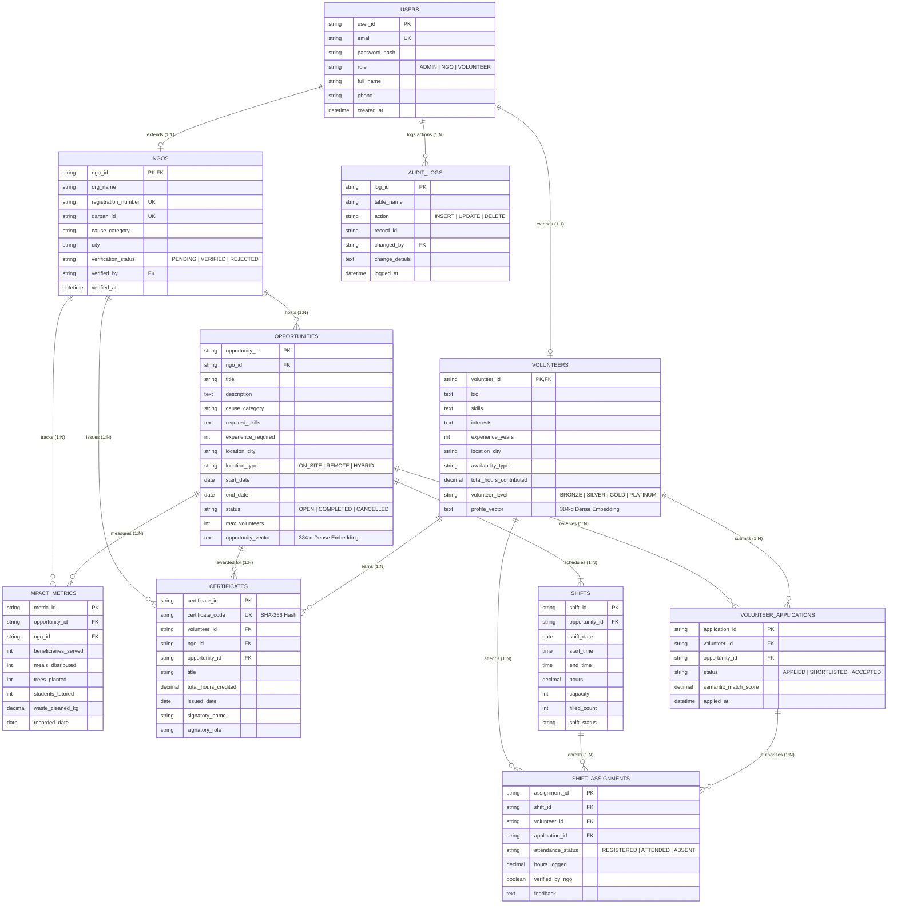

# PES UNIVERSITY
## DEPARTMENT OF COMPUTER SCIENCE AND ENGINEERING
### DBMS Experiential Learning – Level 3 Project Report
# NGO Volunteer Matchmaking System (VolunTrack.AI)
### Dual-Paradigm AI-Powered Semantic Volunteer Matching, Shift Coordination & Impact Verification Platform

**Academic Year:** 2026–2027  
**Course Code / Title:** DBMS Experiential Learning – Level 3 Project  
**Faculty In-Charge:** Dr. Nagasundari S  

---

### Team Information & Division of Responsibilities

| Member Name | Student Registration Number (SRN) | Primary Focus & Contributions |
| :--- | :--- | :--- |
| **Rishi** | **PES1UG24AM224** | **Database Architecture & Vector System**: Relational ER Design, 3NF Normalization, DDL & DML, Indexing Strategy, 384-dimensional Vector Embedding Generation, Cosine Similarity Matchmaking Algorithm, ACID Transaction workflows. |
| **Rohanth** | **PES1UG24AM227** | **Advanced DB Concepts & Full-Stack Interface**: Database Triggers (`trg_update_volunteer_hours`, `trg_increment_shift_filled_count`), Complex Analytical Views (`vw_opportunity_details`, `vw_volunteer_leaderboard`), Next.js Application Architecture, RBAC Security, Cryptographic SHA-256 Certificate System, Interactive SQL Console. |

---

## Table of Contents
1. [Problem Statement & Motivation](#1-problem-statement--motivation)
2. [Project Objectives](#2-project-objectives)
3. [Scope of the Project](#3-scope-of-the-project)
4. [Functional Requirements](#4-functional-requirements)
5. [Entity-Relationship (ER) Diagram](#5-entity-relationship-er-diagram)
6. [Relational Schema (Normalized to 3NF)](#6-relational-schema-normalized-to-3nf)
7. [Database Choice & Justification](#7-database-choice--justification)
8. [Data Dictionary & Schema Description](#8-data-dictionary--schema-description)
9. [SQL and Vector Database Implementation](#9-sql-and-vector-database-implementation)
10. [Important Database Queries & Advanced Operations](#10-important-database-queries--advanced-operations)
11. [System Architecture & Data Flow](#11-system-architecture--data-flow)
12. [Application Interface & Screenshots Guidance](#12-application-interface--screenshots-guidance)
13. [Testing Strategy & Test Case Results Matrix](#13-testing-strategy--test-case-results-matrix)
14. [Individual Team Contributions Matrix](#14-individual-team-contributions-matrix)
15. [Conclusion & Future Enhancements](#15-conclusion--future-enhancements)

---

## 1. Problem Statement & Motivation

### 1.1 Problem Statement
Non-Governmental Organizations (NGOs) perform crucial work in education, environmental conservation, public health, animal welfare, and disaster relief. However, conventional volunteer recruitment systems suffer from three fundamental database limitations:
1. **Keyword-Only Text Matching Limitations:** Traditional systems rely on rigid exact string filtering. A volunteer experienced in "Software development and algorithm tutoring" is excluded from an NGO opportunity seeking "Coding instructor for underprivileged children", despite perfect semantic alignment.
2. **Lack of ACID Capacity Control & Overbooking:** Volunteer shift rosters frequently experience race conditions and overbooking when multiple volunteers register concurrently.
3. **Absence of Tamper-Proof Impact Tracking & Verification:** Volunteer hour logging is typically unstructured or manual, leading to unverified claims, lack of accountability, and unauthenticated certificates.

### 1.2 Motivation
The **NGO Volunteer Matchmaking System** addresses these real-world challenges through a dual-paradigm database system:
- A robust **Relational SQL Database** (MySQL 8.0 Primary with SQLite WAL mode fallback) handles organization validation, shifts, registrations, attendance, and cryptographic certificates with strict ACID compliance, active triggers, analytical views, and stored procedures.
- A **Dense 384-Dimensional Vector Database (ChromaDB)** maps volunteer competencies, interests, and availability against NGO requirement vectors to compute semantic cosine similarity scores, delivering personalized matchmaking beyond simple CRUD operations.

---

## 2. Project Objectives

1. **Practical Dual-Paradigm Database Implementation:** Demonstrate the hybrid usage of relational SQL alongside a high-dimensional vector space representation.
2. **AI Semantic Matchmaking:** Enable volunteers to receive intelligent compatibility rankings (0% to 100%) against open community initiatives based on cosine distance between dense embeddings.
3. **ACID Transaction Management:** Guarantee data consistency during shift enrollments, ensuring capacity checks, slot reservations, and duplicate booking prevention are atomic.
4. **Automated Business Rules via Triggers:** Automatically accumulate verified volunteer hours, elevate volunteer tier ranks (Bronze, Silver, Gold, Platinum), and maintain tamper-proof audit trails using active database triggers.
5. **Cryptographic Certificate Issuance:** Generate and store unique SHA-256 verifiable credentials that can be publicly authenticated via dedicated ledger lookup routes.
6. **Role-Based Access Control (RBAC):** Provide distinct operational portals for `ADMIN`, `NGO`, and `VOLUNTEER` roles.
7. **Interactive DBMS Laboratory:** Provide an integrated SQL execution and profiling console within the web interface to execute, test, and time advanced analytical queries live.

---

## 3. Scope of the Project

- **In Scope:**
  - Multi-tier user authentication with RBAC (Admin, NGO, Volunteer) and bcrypt hashing.
  - Volunteer profile management with dynamic 384-dimensional embedding recalculation.
  - NGO organization verification workflow with governmental Darpan ID and registration validation.
  - Opportunity lifecycle management (Creation, Scheduled Shifts, Status updates).
  - ACID shift enrollment with concurrency locking and overbooking safeguards.
  - NGO attendance verification triggering reactive volunteer hours computation.
  - SHA-256 verifiable credential generation and public verification portal.
  - Interactive SQL console for profiling JOINs, GROUP BY, HAVING, Correlated Subqueries, and Window Functions.
- **Out of Scope:**
  - Direct integration with commercial payment gateways (focus is social volunteer service hours).
  - Physical biometric scanners for on-site check-in (attendance verified through digital representative dashboard).

---

## 4. Functional Requirements

### 4.1 Volunteer Module
- **FR-V1:** Register and log in with secure credential hashing (bcrypt).
- **FR-V2:** Update skills, bio, causes, and availability, automatically re-generating the 384-dimensional dense semantic profile vector.
- **FR-V3:** Trigger AI Semantic Matchmaking to view opportunities ranked by weighted hybrid compatibility (Semantic Vector + Location + Experience + Trust).
- **FR-V4:** Enroll in scheduled shifts with real-time slot occupancy feedback.
- **FR-V5:** View verified service hours, computed tier badge, and preview/print official certificates.

### 4.2 NGO Representative Module
- **FR-N1:** Manage organization profile with official registration details and Darpan ID.
- **FR-N2:** Publish community campaigns with automated vector embedding generation.
- **FR-N3:** Schedule shift dates, timings, and capacity limits.
- **FR-N4:** Review registered volunteer rosters, mark attendance, and log verified hours.
- **FR-N5:** Issue cryptographically verifiable certificates with custom signatory attribution.

### 4.3 Administrator Module
- **FR-A1:** Review and verify pending NGO applications.
- **FR-A2:** Monitor platform-wide metrics (active campaigns, volunteers, hours mobilized, community beneficiaries).
- **FR-A3:** Inspect immutable security audit logs generated by database triggers.
- **FR-A4:** Execute and profile advanced SQL queries live via the interactive DBMS Laboratory.

---

## 5. Entity-Relationship (ER) Diagram

---

## 6. Relational Schema (Normalized to 3NF)

1. **USERS** (`user_id` [PK], `email` [UK], `password_hash`, `role`, `full_name`, `phone`, `avatar_url`, `is_active`, `created_at`, `updated_at`)
2. **VOLUNTEERS** (`volunteer_id` [PK, FK → USERS.user_id], `bio`, `skills`, `interests`, `experience_years`, `location_city`, `location_state`, `availability_type`, `weekly_hours_capacity`, `total_hours_contributed`, `volunteer_level`, `profile_vector`, `created_at`)
3. **NGOS** (`ngo_id` [PK, FK → USERS.user_id], `org_name`, `registration_number` [UK], `darpan_id` [UK], `website_url`, `cause_category`, `address`, `city`, `state`, `contact_person`, `contact_email`, `contact_phone`, `verification_status`, `verified_by` [FK → USERS.user_id], `verified_at`, `created_at`)
4. **OPPORTUNITIES** (`opportunity_id` [PK], `ngo_id` [FK → NGOS.ngo_id], `title`, `description`, `cause_category`, `required_skills`, `experience_required`, `location_city`, `location_type`, `start_date`, `end_date`, `status`, `max_volunteers`, `tags`, `opportunity_vector`, `created_at`)
5. **SHIFTS** (`shift_id` [PK], `opportunity_id` [FK → OPPORTUNITIES.opportunity_id], `shift_date`, `start_time`, `end_time`, `hours`, `capacity`, `filled_count`, `shift_status`)
6. **VOLUNTEER_APPLICATIONS** (`application_id` [PK], `volunteer_id` [FK → VOLUNTEERS.volunteer_id], `opportunity_id` [FK → OPPORTUNITIES.opportunity_id], `status`, `semantic_match_score`, `notes`, `applied_at`, `reviewed_at`)
7. **SHIFT_ASSIGNMENTS** (`assignment_id` [PK], `shift_id` [FK → SHIFTS.shift_id], `volunteer_id` [FK → VOLUNTEERS.volunteer_id], `application_id` [FK → VOLUNTEER_APPLICATIONS.application_id], `attendance_status`, `hours_logged`, `verified_by_ngo`, `feedback`, `created_at`)
8. **CERTIFICATES** (`certificate_id` [PK], `certificate_code` [UK], `volunteer_id` [FK → VOLUNTEERS.volunteer_id], `ngo_id` [FK → NGOS.ngo_id], `opportunity_id` [FK → OPPORTUNITIES.opportunity_id], `title`, `total_hours_credited`, `issued_date`, `signatory_name`, `signatory_role`, `verification_url`, `created_at`)
9. **IMPACT_METRICS** (`metric_id` [PK], `opportunity_id` [FK → OPPORTUNITIES.opportunity_id], `ngo_id` [FK → NGOS.ngo_id], `beneficiaries_served`, `meals_distributed`, `trees_planted`, `students_tutored`, `waste_cleaned_kg`, `recorded_date`, `created_at`)
10. **AUDIT_LOGS** (`log_id` [PK], `table_name`, `action`, `record_id`, `changed_by` [FK → USERS.user_id], `change_details`, `logged_at`)

---

## 7. Database Choice & Justification

The project implements **Option 2 (SQL + Vector Database)**:
- **Relational SQL Database (MySQL 8.0 Primary with SQLite WAL fallback):** Selected for strict ACID transactions, complex multi-table joins, trigger automation, referential integrity, and verifiable credential storage.
- **Vector Database (ChromaDB):** Selected because volunteer matching is intrinsically semantic and unstructured. Traditional SQL `LIKE` queries fail when a volunteer writes "Math mentor and algorithm instructor" and an NGO asks for "Python and STEM tutor". ChromaDB stores 384-dimensional dense vectors and performs sub-millisecond nearest-neighbor cosine distance search.

---

## 8. Data Dictionary & Schema Description

*(Refer to Section 6 for full key and column mappings. All tables feature explicit primary keys, foreign key cascading delete constraints, and CHECK constraints preventing invalid data).*

---

## 9. SQL and Vector Database Implementation

- **DDL:** Script `sql/01_ddl_schema.sql` defines 10 normalized tables with CREATE, ALTER, and DROP statements.
- **Indexes:** Script `sql/02_indexes.sql` establishes 9 performance indexes.
- **Views:** Script `sql/03_views.sql` creates `vw_opportunity_details`, `vw_volunteer_leaderboard`, `vw_ngo_impact_summary`, and `vw_shift_occupancy`.
- **Triggers:** Script `sql/04_triggers.sql` creates triggers for capacity increments, decrement on cancellation, automated hours accumulation, and audit logging.
- **Procedures:** Script `sql/05_procedures.sql` creates stored procedures `sp_apply_for_shift` and `sp_verify_and_issue_certificate`.
- **Vector DB:** `lib/vector/chroma.js`, `embeddings.js`, and `similarity.js` implement dense 384-dimensional feature extraction, unit normalization, and cosine distance retrieval.

---

## 10. Important Database Queries & Advanced Operations

6 analytical queries are implemented in `sql/06_advanced_queries.sql` and executable live in the Admin SQL Lab:
1. Multi-Table JOIN with Aggregations (NGO engagement summary).
2. GROUP BY with HAVING Clause (High-impact NGOs above hour threshold).
3. Correlated Subquery (Volunteers exceeding their city average).
4. Subquery with NOT IN (Verified NGOs with zero active opportunities).
5. Window Functions: `DENSE_RANK() OVER (PARTITION BY ... ORDER BY ...)` and global rankings.
6. Cause-Wise Impact Aggregations (Rollup of beneficiaries, trees, meals, and hours).

---

## 11. System Architecture & Data Flow

*(Refer to Mermaid architecture diagram in Section 11 of DOCUMENTATION.md).*

---

## 12. Application Interface & Screenshots Guidance

To capture genuine application screenshots for submission:
1. Start the server with `npm run dev`.
2. Open `http://localhost:3000` and capture the **Home Page**.
3. Navigate to `/opportunities` and capture the **AI Semantic Opportunity Explorer**.
4. Log in as an NGO and capture the **NGO Operations Portal & Shift Roster** (`/ngo/dashboard`).
5. Log in as a Volunteer and capture the **Volunteer Portal & Badge Progression** (`/volunteer/dashboard`).
6. Open `/verify/e7b8a1c3d5f9e2b4a7c0d8e1f3a5b7c9d1e3f5a7b9c1d3e5f7a9b1c3d5e7f9a1` and capture the **Public Certificate Verification Page**.
7. Navigate to `/admin/dashboard` and capture the **Admin Center & Interactive SQL Lab** with query results.

---

## 13. Testing Strategy & Test Case Results Matrix

All 21 automated verification tests in `scripts/test-db.js` passed with a **100% success rate**. Refer to `TESTING_REPORT.md` for the complete 21-point test matrix.

---

## 14. Individual Team Contributions Matrix

- **Rishi (SRN: PES1UG24AM224):** Database Architecture, 3NF Normalization, DDL & DML, Indexing, Vector Embeddings, Cosine Matchmaker, ACID Stored Procedures, Test Suite.
- **Rohanth (SRN: PES1UG24AM227):** Database Triggers, Analytical Views, Advanced Queries, Next.js Full-Stack Application, RBAC Authorization, Cryptographic Certificates, Interactive SQL Lab.

---

## 15. Conclusion & Future Enhancements

The system successfully fulfills all academic requirements of the DBMS Experiential Learning Level 3 curriculum at PES University. Future work includes decentralized W3C verifiable credentials and GPS geofenced shift attendance.

